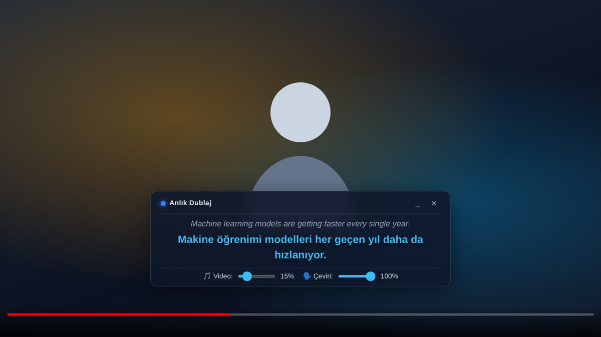

<p align="center">
  
</p>

<h1 align="center">Anlık Dublaj</h1>

<p align="center">
  <b>Listen to any video in your own language, in real time.</b>
</p>

<p align="center">
  <a href="../../releases/latest"></a>
  <a href="../../actions/workflows/ci.yml"></a>
  <a href="LICENSE"></a>
</p>

<p align="center"><a href="README.md">Türkçe</a> · <b>English</b></p>

<p align="center">
  
</p>

_Anlık Dublaj_ is Turkish for "instant dubbing". This Chrome extension streams a tab's audio to Google's [Gemini Live Translate API](https://ai.google.dev/gemini-api/docs/live-api/live-translate) and plays the translated speech back immediately. The original audio keeps playing quietly underneath, like a documentary voice-over.

> The extension's interface is currently in Turkish. The translation itself works into any of the 20 supported target languages.

## Features

- 🎧 **Speech-to-speech:** No captions needed. The model listens to the audio and speaks the translation.
- 🌍 **20 target languages:** Turkish, English, German, Japanese, Arabic and more.
- 🖥️ **Works on any site:** YouTube, course platforms, anything that plays audio in a tab.
- 🎚️ **Separate volume controls** for the original audio and the translation.
- 💬 **Live captions** in a draggable box over the video.
- 🔇 **Quota friendly:** No audio is sent while the video is paused or silent.
- ⌨️ **Keyboard shortcut:** Toggle with `Alt+Shift+D`.

## Installation

1. Download `anlik-dublaj-vX.Y.Z.zip` from the [latest release](../../releases/latest) and unzip it.
   > Don't delete or move the folder afterwards. Chrome runs the extension from it.
2. Open `chrome://extensions` and turn on **Developer mode** (top right).
3. Click **Load unpacked** and select the unzipped `anlik-dublaj` folder.
4. Create an API key in [Google AI Studio](https://aistudio.google.com/api-keys).
5. Click the extension icon, paste the key into **Gemini API Anahtarı** and press **Kaydet & Doğrula** (Save & Validate).

## Usage

1. Open the tab that is playing the video.
2. Click the extension icon, choose the target language (**Hedef Dil**) and turn on **Canlı Çeviri** (Live Translation), or press `Alt+Shift+D`.
3. Adjust the volumes in the popup or in the box over the video.
4. To stop, turn the switch off, press the shortcut again, or click ✕ on the box.

## Good to Know

- Uses the `gemini-3.5-live-translate-preview` model, which is in preview. Usage counts against your own API key's quota and billing.
- Your API key is stored in Chrome's synced settings area (`chrome.storage.sync`): if Chrome Sync is on, it also travels to your other devices signed in to your Google account. It is sent only to Google's API and never shared with the sites you visit.
- One tab can be translated at a time.
- Changing the target language takes effect the next time translation is turned on.
- Quality may drop with loud background music or many overlapping speakers.

## Privacy

- **What is sent:** while translation is on, only that tab's **audio** is sent to Google's Gemini API. No video, page content, cookies or browsing history.
- **Where:** audio goes straight to Google (`generativelanguage.googleapis.com`) with your own API key. There is no server in between; the developer receives no data.
- **Heads-up:** whatever plays in the tab is sent. If you play a meeting, a video call or a private recording in that tab while translation is on, its audio goes to Google too.
- **Google's use:** audio sent is covered by the [Gemini API Additional Terms](https://ai.google.dev/gemini-api/terms). On the free tier Google may use content to improve its products; paid-tier terms differ. Check the current terms.
- **Stored:** the extension does not save transcripts or audio. Only your settings (API key, target language, volume levels) are kept in Chrome's settings storage and are removed when you uninstall.
- **Why it runs on every site:** it can't know in advance where you'll watch a video, so it asks to place its subtitle overlay on any page. That script does not read page text; it only adds subtitles and audio controls on top of the video player.

## Development

You don't need any tooling to use the extension. The following is only for contributors and requires [Node.js](https://nodejs.org/) 22+.

```bash
npm install
npm run check     # ESLint + Prettier check + unit tests
npm run format    # format the code with Prettier
npm run package   # build an installable zip under dist/
```

To release, bump the version in `manifest.json` and `package.json`, add a section to `CHANGELOG.md`, and push a `vX.Y.Z` tag. GitHub Actions builds the zip and publishes the release.

## License

[MIT](LICENSE)

This project is not affiliated with Google. "Gemini" and "Google" are trademarks of Google LLC.
