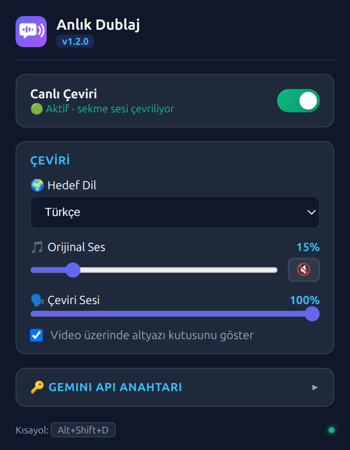

<p align="center">
  
</p>

<h1 align="center">Anlık Dublaj</h1>

<p align="center">
  Tarayıcıda izlediğin videoları <b>gerçek zamanlı olarak kendi dilinde dinle.</b>
</p>

<p align="center">
  <a href="../../releases/latest"></a>
  <a href="../../actions/workflows/ci.yml"></a>
  <a href="LICENSE"></a>
</p>

<p align="center"><b>Türkçe</b> · <a href="README.en.md">English</a></p>

<p align="center">
  
</p>

Anlık Dublaj, sekmedeki sesi Google'ın [Gemini Live Translate API](https://ai.google.dev/gemini-api/docs/live-api/live-translate)'sine akıtır. Gelen çeviri sesini anında çalar. Orijinal ses arkada kısık olarak duyulmaya devam eder, böylece belgesel dublajı gibi bir deneyim elde edersin.

## Özellikler

- 🎧 **Sesten sese çeviri:** Altyazı gerekmez. Konuşmayı model doğrudan dinler ve seçtiğin dilde seslendirir.
- 🌍 **20 hedef dil:** Türkçe, İngilizce, Almanca, Japonca, Arapça ve daha fazlası.
- 🖥️ **Her sitede çalışır:** YouTube, eğitim platformları ve ses çıkaran her sekmede kullanılabilir.
- 🎚️ **Ayrı ses kontrolü:** Orijinal sesi ve çeviri sesini bağımsız olarak ayarlayabilirsin.
- 💬 **Canlı altyazı:** Video üzerinde sürüklenebilir bir kutuda orijinal konuşma ve çevirisi gösterilir.
- 🔇 **Kota dostu:** Video durduğunda veya sessizken API'ye ses gönderilmez.
- ⌨️ **Klavye kısayolu:** `Alt+Shift+D` ile çeviriyi tek tuşla aç/kapat.



## Kurulum

1. [Son sürüm](../../releases/latest) sayfasından `anlik-dublaj-vX.Y.Z.zip` dosyasını indir ve bir klasöre çıkar.
   > Klasörü sonradan silme veya taşıma. Chrome eklentiyi bu klasörden çalıştırır.
2. Chrome'da `chrome://extensions` adresini aç ve sağ üstten **Geliştirici modu**nu etkinleştir.
3. **Paketlenmemiş öğe yükle** butonuna tıkla ve çıkardığın `anlik-dublaj` klasörünü seç.
4. [Google AI Studio](https://aistudio.google.com/api-keys)'dan bir API anahtarı oluştur.
5. Eklenti simgesine tıkla, **Gemini API Anahtarı** bölümüne anahtarı yapıştır ve **Kaydet & Doğrula**'ya bas.

## Kullanım

1. Videonun oynadığı sekmeyi aç.
2. Eklenti simgesine tıkla, hedef dili seç ve **Canlı Çeviri** anahtarını aç. İstersen `Alt+Shift+D` kısayolunu da kullanabilirsin.
3. Ses seviyelerini popup'tan veya video üzerindeki kutudan ayarla.
4. Kapatmak için anahtarı kapat, kısayola tekrar bas veya kutudaki ✕ butonuna tıkla.

Kısayolu değiştirmek için `chrome://extensions/shortcuts` adresini kullanabilirsin.

<br clear="right" />

## Bilinmesi Gerekenler

- Eklenti `gemini-3.5-live-translate-preview` modelini kullanır. Model önizleme aşamasındadır. Kullanım, kendi API anahtarının kota ve ücretlendirmesine tabidir.
- API anahtarın yalnızca tarayıcında (`chrome.storage.sync`) saklanır. Sadece Google'ın API'sine gönderilir, ziyaret ettiğin sitelerle paylaşılmaz.
- Aynı anda tek bir sekme çevrilebilir.
- Hedef dil değişikliği, çeviri kapatılıp yeniden açıldığında geçerli olur.
- Yoğun arka plan müziği veya çok konuşmacılı sahnelerde çeviri kalitesi düşebilir.

## Nasıl Çalışır?

```
Sekme sesi ──tabCapture──▶ Offscreen belge ──16 kHz PCM──▶ Gemini Live API (WebSocket)
                              │       (sessizlik filtresi)            │
                              ▼                                      ▼
                   Orijinal ses (kısık)                24 kHz çeviri sesi + transkript
                                                                     │
                                    Hoparlör ◀───────────────────────┤
                                    Video üzerindeki kutu ◀──────────┘
```

| Klasör        | Görev                                                                        |
| ------------- | ---------------------------------------------------------------------------- |
| `popup/`      | Tüm ayarlar ve açma/kapama. Sekme yakalama iznini alır.                      |
| `background/` | Durum yönetimi, kısayol, offscreen belge ve transkriptlerin sekmeye iletimi. |
| `offscreen/`  | Ses yakalama, 16 kHz'e dönüştürme, sessizlik filtresi, WebSocket ve çalma.   |
| `content/`    | Video üzerindeki altyazı ve ses kontrol kutusu.                              |
| `shared/`     | Hedef dil listesi.                                                           |

## Geliştirme

Eklentiyi kullanmak için hiçbir araç gerekmez. Aşağıdakiler yalnızca koda katkı vermek isteyenler içindir ve [Node.js](https://nodejs.org/) 22+ gerektirir.

```bash
npm install
npm run check     # ESLint + Prettier kontrolü + birim testleri
npm run format    # kodu Prettier ile biçimlendirir
npm run package   # dist/ altına kurulabilir zip üretir
```

Yeni sürüm yayınlamak için `manifest.json` ve `package.json` içindeki sürümü artır, `CHANGELOG.md`'ye bir bölüm ekle ve `vX.Y.Z` etiketini gönder. GitHub Actions zip'i oluşturup sürümü otomatik yayınlar.

Hata bildirimi ve önerilerin için [Issues](../../issues) sayfasını kullanabilirsin.

## Lisans

[MIT](LICENSE)

Bu proje Google ile bağlantılı değildir. "Gemini" ve "Google", Google LLC'nin ticari markalarıdır.
